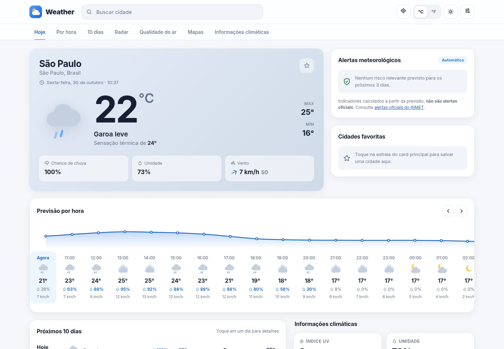
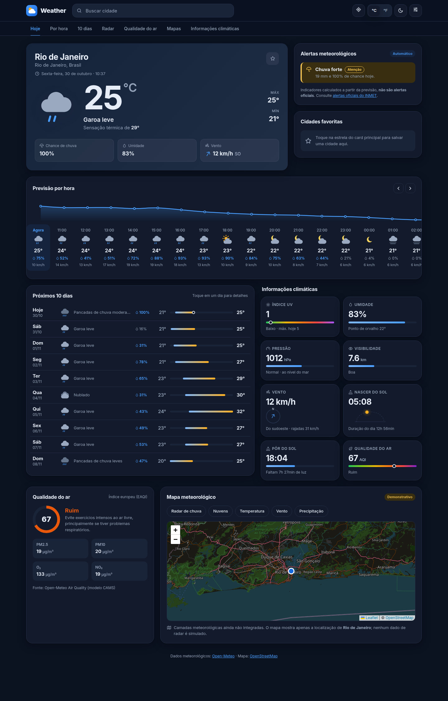
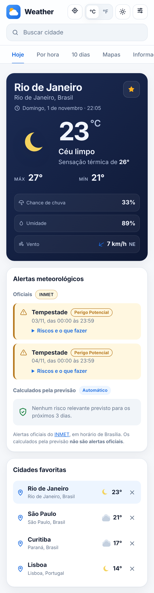
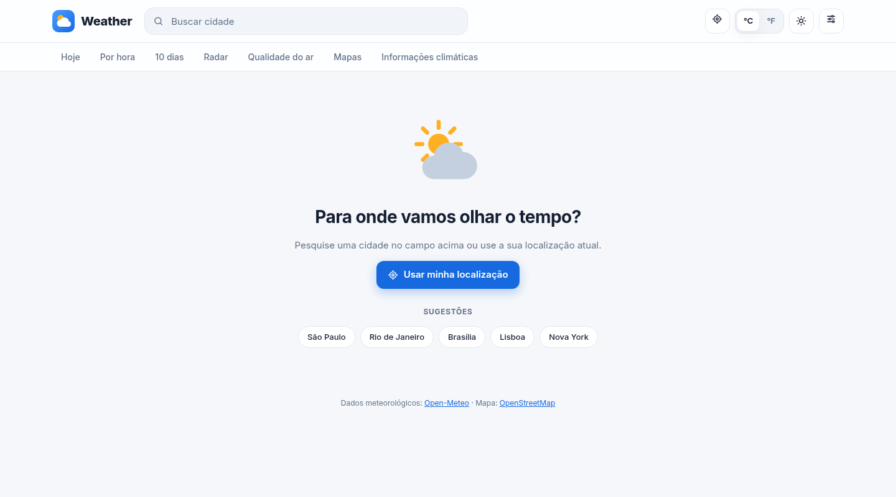

# Weather 🌤️

Mostra o clima de qualquer cidade usando a API gratuita [Open-Meteo](https://open-meteo.com/) (sem chave).
Tem duas formas de usar: no terminal e num painel web completo.

## Prints

**Painel web (modo claro)**



**Painel completo (modo escuro)**



<table>
  <tr>
    <td width="35%"><strong>No celular</strong><br></td>
    <td><strong>Tela inicial</strong><br></td>
  </tr>
</table>

**No terminal**

```
$ python main.py
☀️  App de Clima (dados: Open-Meteo)
Digite uma cidade (ou 'sair'): São Paulo

📍 São Paulo, São Paulo - Brasil
🌡️  Temperatura:      18.6 °C
🤔 Sensação térmica: 20.6 °C
💧 Umidade:          95 %
💨 Vento:            5.2 km/h
🌦️  Tempo:            Garoa intensa
```

## Instalação (Ubuntu)

```bash
sudo apt install python3-venv   # só se ainda não tiver
python3 -m venv .venv
source .venv/bin/activate
pip install -r requirements.txt
```

## Como usar

Terminal:
```bash
python main.py
```

Web:
```bash
python web.py
```
Depois, abra http://127.0.0.1:5000 no navegador.

O painel web tem: clima atual, previsão por hora com gráfico, 10 dias (clique em um dia para ver
detalhes), indicadores (UV, pressão, visibilidade, sol...), qualidade do ar, alertas automáticos,
mapa com vento e nuvens animados, cidades favoritas, °C/°F, modo claro/escuro e localização atual.

> Os **alertas** são calculados a partir da previsão e **não são oficiais**.
> No **mapa**, a camada **Vento** mostra a previsão da Open-Meteo animada (não é medição em tempo real) e a
> camada **Nuvens** mostra imagens reais do satélite GOES (NOAA, via NASA GIBS) das últimas 2 horas, só nas Américas.
> As outras camadas (radar, temperatura, precipitação) ainda são demonstrativas: não há fonte de dados integrada.

## Publicar no Render

O projeto já vem com o arquivo `render.yaml`, que diz ao [Render](https://render.com) como instalar e iniciar o app.

1. Crie uma conta no Render com **Sign in with GitHub**.
2. Clique em **New → Blueprint** e escolha este repositório.
3. Confirme em **Apply**. Em poucos minutos o site fica disponível em um endereço `*.onrender.com`.

A cada `git push` no branch `main`, o Render publica a nova versão sozinho.
No plano gratuito, o site "dorme" após um tempo sem acessos, e a primeira visita depois disso demora um pouco mais.

Na versão web, quem consulta a Open-Meteo é o **navegador de cada visitante**, e não o servidor.
Assim cada pessoa usa o próprio limite gratuito da API, em vez de dividir o limite do endereço
de internet compartilhado da hospedagem.

Para rodar localmente do mesmo jeito que no servidor:
```bash
gunicorn web:app --bind 0.0.0.0:8000
```

## Testes

```bash
pytest
```

## Arquivos

| Arquivo | O que faz |
|---|---|
| `api.py` | Busca cidades, clima, previsão e qualidade do ar na Open-Meteo |
| `descricoes.py` | Traduz o código do tempo para português |
| `interface.py` + `main.py` | App do terminal |
| `painel.py` | Organiza os dados da API no formato do painel web |
| `avisos.py` | Calcula os alertas automáticos (chuva, vento, calor, frio) |
| `web.py` | Servidor Flask: entrega a página e monta o painel a partir dos dados enviados pelo navegador (`POST /api/painel`) |
| `templates/index.html` | Estrutura da página (cabeçalho, abas) |
| `static/css/app.css` | Visual, temas claro/escuro e responsividade |
| `static/js/main.js` | Junta tudo: estado da página e eventos |
| `static/js/servico.js` | Consulta a Open-Meteo direto do navegador e envia os dados ao servidor (camada de dados do front) |
| `static/js/componentes/` | Uma parte da tela por arquivo (card atual, por hora, 10 dias, mapa...) |

## Licença

Distribuído sob a licença MIT. Veja o arquivo [LICENSE](LICENSE).
