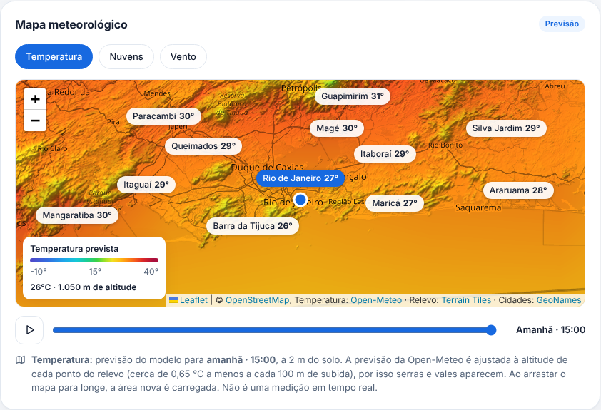
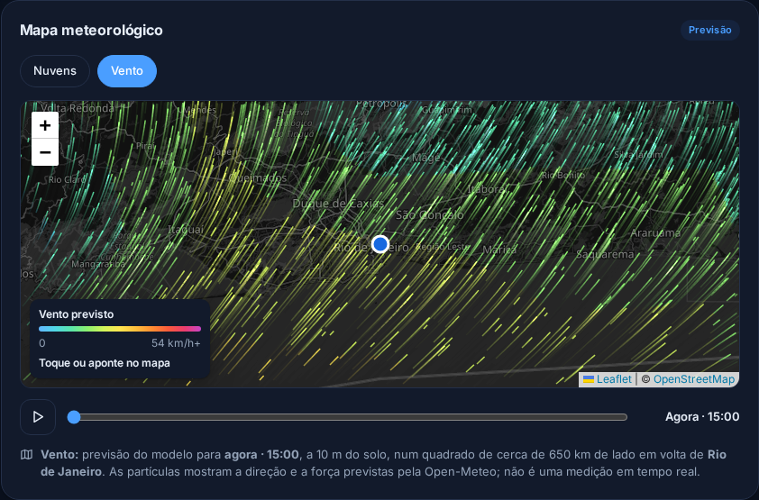
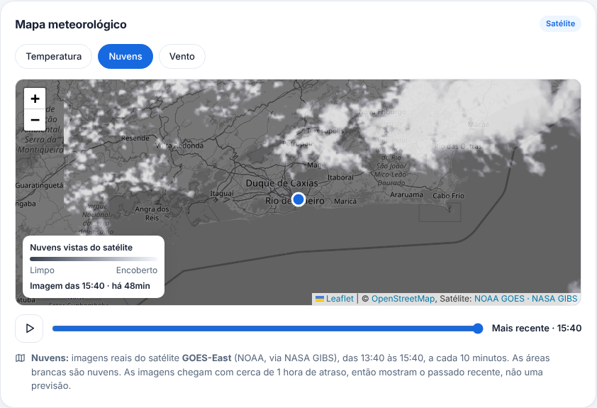

# Weather 🌤️

Mostra o clima de qualquer cidade usando a API gratuita [Open-Meteo](https://open-meteo.com/) (sem chave).
Tem duas formas de usar: no terminal e num painel web completo.

**Acesse o painel online:** https://gabrielfaria7.github.io/weather/

> O painel é um site estático no GitHub Pages: abre na hora, sem servidor para "acordar".

## Prints

**Painel web (modo claro)**


**Painel completo (modo escuro)**


<table>
  <tr>
    <td width="35%"><strong>No celular</strong><br></td>
    <td><strong>Tela inicial</strong><br></td>
  </tr>
</table>

### Mapa com temperatura, vento e nuvens

**Temperatura (modo claro)**



<table>
  <tr>
    <td width="50%"><strong>Vento (modo escuro)</strong><br></td>
    <td width="50%"><strong>Nuvens (modo claro)</strong><br></td>
  </tr>
</table>

**No terminal**

```
$ python main.py
☀️  App de Clima (dados: Open-Meteo)
Digite uma cidade (ou 'sair'): São Paulo

📍 São Paulo, São Paulo - Brasil
🌡️  Temperatura:      18.6 °C
🤔 Sensação térmica: 20.6 °C
💧 Umidade:          95 %
💨 Vento:            5.2 km/h
🌦️  Tempo:            Garoa intensa
```

## Instalação (Ubuntu)

```bash
sudo apt install python3-venv   # só se ainda não tiver
python3 -m venv .venv
source .venv/bin/activate
pip install -r requirements.txt
```

## Como usar

Terminal:
```bash
python main.py
```

Web (o painel é só HTML, CSS e JavaScript, na pasta `site/`, então basta um servidor de arquivos):
```bash
python3 -m http.server -d site 8000
```
Depois, abra http://127.0.0.1:8000 no navegador.

O painel web tem: clima atual, previsão por hora com gráfico de temperatura, chuva ou vento, 10 dias (clique em um dia para ver
detalhes), indicadores (UV, pressão, visibilidade, sol...), qualidade do ar (índice brasileiro IQAr ou europeu EAQI),
alertas oficiais do INMET e automáticos,
mapa com temperatura (mapa de calor com relevo), vento e nuvens animados, cidades favoritas (com a temperatura de agora em cada uma), °C/°F, modo claro/escuro e localização atual.
O card principal tem um resumo das próximas horas em uma frase ("Chuva a partir das 15:00 (80% de chance) e máxima de 28° às 14:00"),
a comparação com ontem ("Hoje está 3° mais quente que ontem") e um botão para compartilhar a previsão (WhatsApp etc.);
cada cidade favorita do Brasil mostra um selo colorido quando tem alerta oficial do INMET.
No fim do painel ficam a **Lua** (fase, % iluminada, nascer e pôr, próximas lua cheia e nova, calculados no navegador)
e, para cidades do litoral, o **Mar** (altura, período e direção das ondas e temperatura da água, da Open-Meteo Marine).
O painel aparece assim que a previsão chega; alertas do INMET, qualidade do ar e mar completam em seguida, e os gráficos e o
mapa só são baixados quando chegam perto da tela.
Com o painel aberto, a previsão se atualiza sozinha a cada 15 minutos (o card principal mostra "Atualizado há X min"; toque nele para atualizar na hora).

> **Instale como aplicativo:** no Chrome/Edge, use o ícone de instalar na barra de endereço (ou
> **Configurações → Instalar como aplicativo** no painel); no iPhone, **Compartilhar → Adicionar à Tela de Início**.
> Sem internet, o app abre normalmente e mostra a última previsão salva de cada cidade (com aviso de quando ela é).

> **Qualidade do ar:** por padrão o painel mostra o **IQAr**, o índice oficial do Brasil (Resolução CONAMA 506/2024),
> calculado com as médias de 24 h, 8 h e 1 h que a norma exige a partir da estimativa do modelo CAMS (Open-Meteo).
> Nas configurações dá para trocar para o índice europeu (EAQI). É estimativa de modelo, não medição de estação.
>
> **Alertas:** para cidades do Brasil, o painel mostra os **alertas oficiais do INMET** (avisos ativos da área da
> cidade, com severidade, período, riscos e o que fazer). Abaixo deles ficam os alertas **automáticos**, calculados
> a partir da previsão, que **não são oficiais**.
>
> **Tempo de agora medido (Brasil):** o "agora" da Open-Meteo é uma estimativa de modelo e às vezes diz que está
> chovendo quando não está. Para cidades do Brasil, o card principal usa a **estação automática do INMET mais
> próxima** (até 50 km, medição de até 3 h atrás): temperatura, sensação, umidade, vento e chuva da última hora.
> Se a estação mediu 0 mm, o card não diz que está chovendo. A linha "Medido às 08:00 na estação Curitiba do INMET,
> a 5 km" mostra de onde vem o número; sem estação perto, aparece "estimativa do modelo da Open-Meteo".
>
> **Previsão oficial (Brasil):** um card com a previsão dos meteorologistas do INMET para o município: manhã, tarde
> e noite de hoje e amanhã, e mais três dias. A previsão por hora e a de 10 dias continuam vindo da Open-Meteo.
> No **mapa**, a camada **Temperatura** mostra a previsão da Open-Meteo das próximas 24 horas como mapa de calor,
> ajustada à altitude de cada ponto do relevo (AWS Terrain Tiles), para serras e vales aparecerem, com os nomes e as
> temperaturas das cidades (lista do GeoNames); ao arrastar o mapa para longe, a área nova é carregada. A camada
> **Vento** mostra a previsão da Open-Meteo animada (nenhuma das duas é medição em tempo real) e a
> camada **Nuvens** mostra imagens reais de satélite do mundo todo (menos perto dos polos): GOES (NOAA, via NASA GIBS)
> nas Américas e Meteosat MTG (EUMETSAT) na Europa, África e Oriente Médio, a cada 10 minutos; na Ásia e Oceania,
> o mosaico de satélites geoestacionários da EUMETSAT, a cada 3 horas.

## Publicar

O painel web é um **site estático**: a pasta `site/` tem tudo (HTML, CSS e JavaScript). O navegador de cada
visitante consulta a Open-Meteo e monta o painel sozinho, sem servidor. Assim cada pessoa usa o próprio limite
gratuito da API e o site abre na hora.

A cada `git push` no `main`, o GitHub Actions roda os testes e, se passarem, publica a pasta `site/` no
GitHub Pages, em https://gabrielfaria7.github.io/weather/ (`.github/workflows/testes.yml`).
Para ativar num repositório novo: **Settings → Pages → Build and deployment → Source: GitHub Actions**.

## Segurança

O painel carrega Chart.js e Leaflet de CDNs públicas. Para evitar que um arquivo adulterado na CDN rode no site,
cada um tem verificação de integridade (SRI): o navegador só executa o arquivo se ele for idêntico ao esperado.
A página também tem uma política de segurança de conteúdo (CSP) que só libera os sites que o painel realmente
usa (Open-Meteo, NASA GIBS, EUMETSAT, OpenStreetMap e as CDNs). Um teste automático confere essas proteções.

## Atualizações

O Dependabot (`.github/dependabot.yml`) confere toda segunda-feira se há versões novas das dependências Python
(`requirements.txt` e `requirements-dev.txt`) e das ações usadas no GitHub Actions. Quando há, ele abre um pull
request com tudo agrupado; os testes rodam sozinhos no pull request e, se passarem, basta fazer o merge.

As bibliotecas carregadas por CDN no `site/index.html` (Chart.js e Leaflet) são atualizadas manualmente, porque
cada troca de versão exige recalcular a verificação de integridade.

## Testes

Python (app do terminal) — as ferramentas de teste ficam em `requirements-dev.txt`:

```bash
pip install -r requirements-dev.txt
pytest
```

JavaScript (painel, alertas, resumo do dia, lua, mar, compartilhar, atualização automática, consultas às APIs, previsão offline, satélites, vento, mapa de calor, formatação, preferências, aplicativo e segurança da página) — usa o executor de testes que já vem no Node.js 22 ou mais novo:

```bash
node --test "tests/js/*.test.mjs"
```

No navegador (Chrome de verdade, com as APIs respondendo dados de teste): abre o painel nos modos claro, escuro e
celular, liga as camadas do mapa, usa a busca, confere a política de segurança (CSP) e a acessibilidade (axe). O
GitHub roda este teste antes de cada publicação. Para rodar no seu computador, instale as ferramentas sem criar
`package.json`:

```bash
npm install --no-save --no-package-lock playwright@1.63.0 axe-core@4.14.0
```

```bash
npx playwright install chromium
```

```bash
node --test "tests/navegador/*.test.mjs"
```

A cada push no `main` (e em cada pull request), o GitHub Actions roda os três sozinho
(`.github/workflows/testes.yml`). O site só é publicado se todos passarem.

## Arquivos

| Arquivo | O que faz |
|---|---|
| `api.py` | Busca cidades e o clima atual na Open-Meteo (app do terminal) |
| `descricoes.py` | Traduz o código do tempo para português (app do terminal) |
| `interface.py` + `main.py` | App do terminal |
| `site/index.html` | Estrutura da página (cabeçalho, abas) |
| `site/css/app.css` | Visual, temas claro/escuro e responsividade |
| `site/js/main.js` | Junta tudo: estado da página e eventos |
| `site/js/servico.js` | Consulta a Open-Meteo direto do navegador (camada de dados) |
| `site/js/painel.js` | Organiza os dados da API no formato do painel |
| `site/js/avisos.js` | Calcula os alertas automáticos (chuva, vento, calor, frio) |
| `site/js/seriesPorHora.js` | Prepara os gráficos da previsão por hora (temperatura, chuva e vento) |
| `site/js/iqar.js` | Calcula o índice brasileiro de qualidade do ar (IQAr, CONAMA 506/2024) |
| `site/js/alertasOficiais.js` | Escolhe os alertas oficiais do INMET que valem para a cidade |
| `site/js/inmet.js` | Acha o município do INMET, lê a estação mais próxima e a previsão oficial |
| `site/js/descricoes.js` | Traduz o código do tempo para português |
| `site/js/satelites.js` | Escolhe o satélite das nuvens pela região e deixa só as nuvens visíveis na imagem |
| `site/js/gradeVento.js` | Converte a grade de vento para o formato da animação e acha o ponto sob o mouse |
| `site/js/temperaturaMapa.js` | Pinta o mapa de calor da temperatura, corrigida pela altitude do relevo |
| `site/js/resumo.js` | Escreve o resumo das próximas horas e a comparação com ontem |
| `site/js/rotulosMapa.js` | Escolhe quais nomes de cidades cabem no mapa de calor sem se sobrepor |
| `site/dados/cidades/` | Cidades do GeoNames em blocos de 10° (geradas por `ferramentas/gerar_cidades.py`) |
| `site/js/lua.js` | Calcula a fase da lua, o nascer e o pôr e as próximas lua cheia e nova |
| `site/js/compartilhar.js` | Monta o texto e o link para compartilhar (sem expor a localização exata do GPS) |
| `site/js/bibliotecas.js` | Carrega Chart.js e Leaflet da CDN só quando precisa, com verificação de integridade |
| `site/fontes/` | Fonte Inter (licença SIL OFL) servida pelo próprio site |
| `site/js/atualizacao.js` | Decide quando atualizar a previsão sozinho e escreve "Atualizado há X min" |
| `site/js/formato.js` / `preferencias.js` | Formatação (temperatura, vento, horas) e preferências/favoritos salvos no navegador |
| `site/js/componentes/` | Uma parte da tela por arquivo (card atual, por hora, 10 dias, mapa...) |
| `site/favicon.svg`, `*.png` | Ícones do site e do aplicativo e imagem de prévia ao compartilhar o link (Open Graph) |
| `site/manifest.webmanifest` | Dados do aplicativo instalável (nome, cores, ícones) |
| `site/sw.js` | Service worker: guarda os arquivos do site para ele abrir sem internet |
| `ferramentas/og-image.html` | Modelo da imagem de prévia (abrir em 1200 × 630 e tirar o print) |
| `ferramentas/gerar_cidades.py` | Converte a lista de cidades do GeoNames nos blocos de `site/dados/cidades/` |
| `tests/` | Testes em Python (`pytest`), em JavaScript (`tests/js/`, `node --test`) e no navegador (`tests/navegador/`, Playwright) |

## Licença

© 2026 Gabriel Faria. **Todos os direitos reservados.** Você pode ver o código e usar o site, mas não pode
copiar, modificar, publicar ou reutilizar o Weather sem autorização por escrito do autor. Veja o arquivo
[LICENSE](LICENSE).
